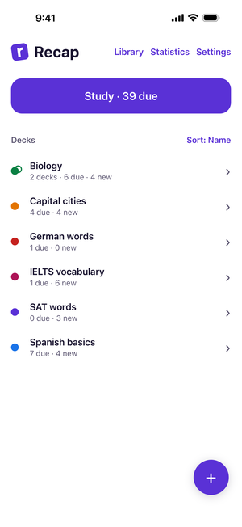
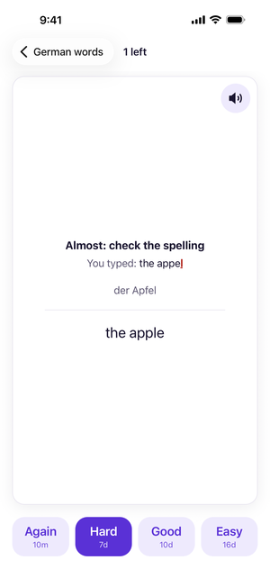
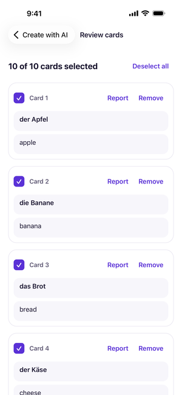
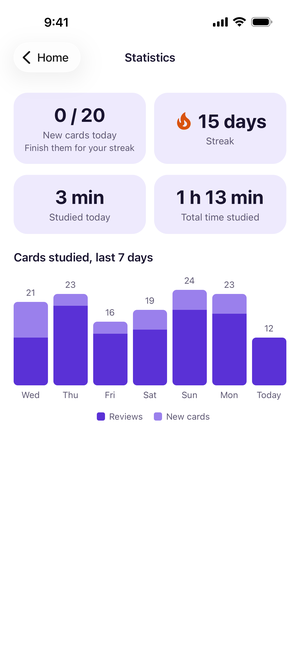

  

<h1 align="center">Recap: Simple AI Flashcards</h1>

  Turn your notes into flashcards in seconds, then study a few minutes a day. 
  Free, no ads, no account. Your cards stay on your phone.

  
  
  
  

  <b>iPhone:</b> <a href="https://apps.apple.com/app/id6822104894">App Store</a> ·
  <b>Android:</b> in testing on Google Play ·
  <b>Web:</b> <a href="https://recapflashcards.com">recapflashcards.com</a>

## Remember more, study less

- **Spaced repetition with FSRS**, a modern, research-based memory algorithm. Cards come back right
  before you would forget them.
- **Active recall:** type the answer and Recap checks it, spots typos, and suggests **Again**,
  **Hard**, **Good** or **Easy**. Each button shows when you'll see the card again. Long answers
  are shown with a tap instead, and Settings can switch to two buttons.
- **One big Study button** shows everything that's due. No settings to learn first.

## Make cards in seconds with AI

- Paste your notes, snap a photo of a textbook page, add a PDF, or just type a topic.
- Cards in any two languages, like German words with English meanings. The AI writes math too.
- Check every card before you save it: edit or remove anything that isn't right, or report a card
  that's wrong or offensive.
- Exam soon? Go from notes to a full deck in a minute.

## Bring the cards you already have

- Import a spreadsheet (`.csv` or `.tsv` from Excel or Google Sheets): front, back and tags.
- Paste a list like `chat - cat`, one card per line.
- Open shared `.apkg` decks.

## Stay on track

- A daily streak that counts when you finish your new cards for the day.
- See how many cards you studied and how much time you spent, day by day.
- An optional daily reminder when you have cards due.

## Made for real studying

- Ready-made decks in the Library (English basics, IELTS, SAT and TOEIC vocabulary, world
  capitals), plus your own for languages, biology, history, medicine and more.
- Decks inside decks (like "Biology › Cells") to keep things tidy.
- Cards read aloud in 19 languages, set once for each deck.
- Math on cards: fractions, roots and powers with "+ Math", no LaTeX needed. Pictures too.
- Light or dark, following your phone. The app is in English and Vietnamese.
- Deleted decks can be restored for 30 days.

## Private by design

Your decks, cards and study history live on your phone and work offline. There are no ads, no
tracking and no account. Only the text you choose to turn into cards with "Create with AI" leaves
your phone: it goes to Google's Gemini AI to write the cards, and Recap asks before it sends anything.
A card you report goes to the developer to review.
Read the [privacy policy](https://recapflashcards.com/privacy).

## How it's built

For anyone reading the code:

| Part | What's inside |
| --- | --- |
| [`app/`](app) | The phone app for Android and iPhone: Expo (React Native) + TypeScript, Expo Router. Everything is stored on the device in SQLite (Drizzle ORM); scheduling uses [ts-fsrs](https://github.com/open-spaced-repetition/ts-fsrs). Text in photos is read on the device. |
| [`app/`](app) on the web | The same app at [recapflashcards.com](https://recapflashcards.com) (Expo web, on Cloudflare Pages); cards stay in the browser. Help and the privacy policy are plain pages in [`app/public/`](app/public). |
| [`server/`](server) | A small FastAPI service that only makes AI cards: it sends the user's text to Google's Gemini API, with a daily limit per device. |

The data layer is built for optional sync later: every row has a UUID, timestamps and soft
deletes, and review history is append-only (see the comments in
[`app/src/db/schema.ts`](app/src/db/schema.ts)).

## Feedback

Questions, ideas or bugs: [support@recapflashcards.com](mailto:support@recapflashcards.com) ·
[Help page](https://recapflashcards.com/support) · [Website](https://recapflashcards.com)
